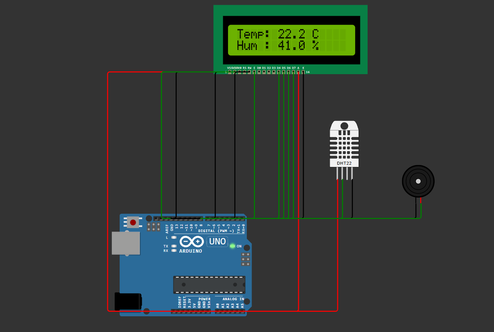

# Temperature & Humidity Monitor (Arduino)

An Arduino Uno based project that reads temperature and humidity from a DHT22 sensor, shows the values on a 16x2 LCD, and sounds a buzzer when the temperature crosses a set limit.

**Simulation:** https://wokwi.com/projects/479949975401205761

## Components
- Arduino Uno
- DHT22 temperature and humidity sensor
- 16x2 LCD (LCD1602)
- Buzzer

## How it works
1. The DHT22 sensor is read every 2 seconds.
2. Temperature and humidity are shown on the LCD.
3. If the temperature goes above 35 °C, the buzzer turns on. Below that, it turns off.
4. If the sensor gives an invalid reading, the LCD shows "Sensor error".

## Pin connections
| Component | Arduino pin |
|---|---|
| DHT22 data | D7 |
| Buzzer | D8 |
| LCD RS | D12 |
| LCD E | D11 |
| LCD D4-D7 | D5, D4, D3, D2 |

## Tools
Arduino (C/C++), Wokwi simulator

## Future improvements
- Build on real hardware
- Use ESP32 to send data to the cloud (IoT)
